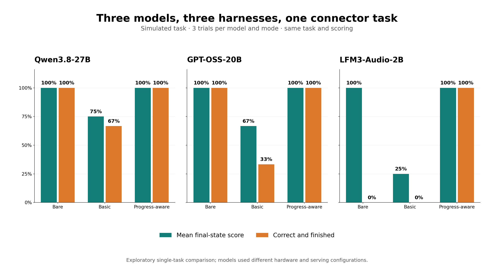

# I made a 2B model finish the job by changing the harness

I was testing local models on a small agent workflow when I found something I didn't expect: the bare model made more progress than my guardrails did.

The job was simple. Create a group, connect it to a mock CRM, give the group read-only access, and verify that Alice could read while Bob could not. Everything ran against a simulated API. No real connector, policy, or user was touched.

I wanted to know whether a small local model could do useful work with the right software around it. So I ran the same task with three models and three harness configurations. The surprising result wasn't just that the 2B model needed help. It was that my first set of guardrails got in its way.



[Explore the benchmark code and raw results](README.md) · [Read the Agentware implementation plan](agentware-workflow-plan.md)

## What I was trying to measure

The harness asks the model for a tool call, runs it against the mock, returns the result, and repeats. I compared:

1. **Bare:** run the model's tool calls without the additional guardrails.
2. **Basic guardrails:** use Agentware's response-quality checks, prerequisites, and retry handling.
3. **Progress-aware harness:** use those building blocks with more flexible ordering, a task-specific checklist built from tool results, error feedback, and a finish-line nudge.

The checklist is part of this demo harness. It isn't a general Agentware SDK feature yet. The code does not infer success from the model saying “I'm done”: the mock independently scores the final state, and completion requires an accepted `done` call.

## The first thing that went wrong

The LFM model created a policy before adding Alice to the group. My basic guardrails rejected that order. After a couple of prerequisite violations, the harness stopped the run.

But in this mock, creating a policy before adding a member is fine. The important part is that the final policy is right and that access checks are rerun after the membership changes.

The bare model was allowed to proceed out of order. It added Alice, reran the checks, and reached the right state. Then it stopped without calling `done`.

That distinction changed the experiment. “Did the agent finish?” and “Did the agent leave the world in the right state?” are related questions, but they aren't the same measurement.

## What I changed

The progress-aware variant keeps the policy and membership steps independent. It tracks what the simulated tools actually returned, clears stale checks when a state-changing action happens, and includes missing work in its feedback. If the observed checklist is satisfied and the model stops without a tool call, the harness asks it to call `done`.

It also retains the enhanced harness's tool-call rescue, bounded diagnostic nudges, repeated-test detection, and compaction of older tool results. The checklist in [enhanced.py](enhanced.py) is deliberately specific to this simulated task; the [workflow plan](agentware-workflow-plan.md) describes how to turn the pattern into reusable library behavior.

One important correction: the original mock expected an `http_api` connector without saying so in the task and couldn't repair an incorrectly created connector. The [corrected scenario](scenarios/access_provisioning_v2.py) states the requirement and adds inspect/update tools. Its results shouldn't be mixed with the earlier scenario.

## The small-model head-to-head

I ran three trials per model and harness on the corrected task. Every configuration got the same task, scoring, temperature, seeds, and turn limit. Qwen ran on my local model server; GPT-OSS and LFM ran on my laptop. The hardware and serving configurations weren't identical, so this is not a speed comparison.

| Model | Bare: correct and finished | Basic guardrails | Progress-aware |
| --- | ---: | ---: | ---: |
| Qwen3.8-27B | 3/3 | 2/3 | 3/3 |
| GPT-OSS-20B | 3/3 | 1/3 | 3/3 |
| LFM3-Audio-2B | 0/3 | 0/3 | 3/3 |

For LFM, the bare runs reached a 100% final-state score but didn't finish; the basic guardrails averaged 25% final-state score and stopped on the retry limit. The progress-aware runs reached the correct state and completed. The chart shows both metrics so the bare model gets credit for the work it actually did.

Three trials on one task are a starting point, not a model leaderboard. Several harness changes were bundled together, and some trajectories repeated. I can't say which individual change caused the difference or that it will hold on other workflows. The [raw results and settings](README.md#matched-three-model-head-to-head) are there to inspect.

## Where Forge fits

Antoine Zambelli's [Forge](https://github.com/antoinezambelli/forge) already provides a lot of the underlying reliability work: validation and rescue, retries, step enforcement, prerequisites, error recovery, and context compaction. Its workflow runner and middleware have different integration boundaries; the [Forge user guide](https://github.com/antoinezambelli/forge/blob/main/docs/USER_GUIDE.md) explains those differences.

Agentware's Python guardrails facade is adapted from Forge's design. This benchmark uses Agentware guardrails plus additional demo-harness logic; it doesn't run the Forge package directly. The task-specific progress checklist isn't yet an Agentware feature.

## Run the experiment

The runnable [benchmark README](README.md) has the model settings, source revision, scenario, and raw JSONL. You'll need Python 3.10+, Git, and an OpenAI-compatible model server. From a checkout of this repository, set up an isolated Python environment with the exact Agentware revision used for the new comparison:

```bash
cd agentcon-self-hosting/lfm-benchmark
python3 -m venv .venv
source .venv/bin/activate
pip install "git+https://github.com/HaikeiLabs/Agentware.git@961c026f46a16b42c9ca670a855de44158519#subdirectory=python"
pip install matplotlib numpy pytest
```

Start your model server separately. For a locally installed llama.cpp and a downloaded model file, this is the shape of the command I used (replace the path):

```bash
llama-server --model /path/to/your-model.gguf --host 127.0.0.1 \
  --port 18191 --ctx-size 32768 --parallel 1 --jinja --alias my-local-model
```

Then, from the activated environment in a second terminal:

```bash
LLM_BASE_URL=http://127.0.0.1:18191/v1 \
LLM_MODEL=my-local-model \
python3 probe.py 3 --scenario access_provisioning_v2 --no-parallel \
  --mode bare --mode guarded --mode progress
```

Regenerate the saved head-to-head image with `python3 head_to_head_graph.py`; it uses the checked-in JSONL, not the output of a new run. Use `--trace runs/my-traces.jsonl` only with synthetic data: detailed traces include tool arguments and results. The mock is local, but the model endpoint can be remote, so choose an endpoint you trust.

## What I want to build next

I don't want to ship a library that knows who Alice is or how a CRM should be configured. I want to give a harness reusable ways to describe dependencies, observe progress, invalidate stale verification, bound retries, and ask for a finish when the work is actually ready.

The experiment made the case for testing the harness as carefully as the model. A smaller model may need more guidance, but guidance has to reflect the workflow. Otherwise, the thing we added to keep the agent on track is the thing that stops it from getting there.
