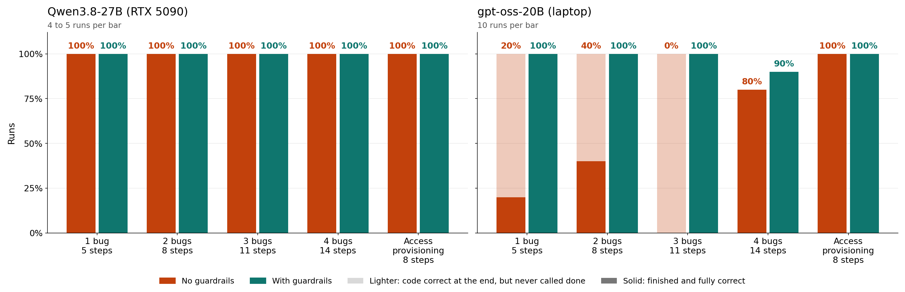

<!-- _class: lead -->

# Self-Hosting Agents

## Small Dense Models Change the Economics

Miriah Peterson · @Soypete<br>
AgentCon / MCP Con · October 23, 2026

---

## Who Am I?

- CEO of Haikai Labs
- Co-host of the **Domesticating AI** podcast
- Building AI systems since 2022

---

<!-- _class: lead -->

# What Is an Agent?

```text
observe → decide → call a tool → inspect the result
   ↑                                      ↓
   └──────────────── repeat ──────────────┘
```

## A model running inside a loop

<!-- A chat response is usually one inference. An agent keeps returning to the
model between actions. The harness—not the model alone—owns tools, state, retries,
and the stopping condition. -->

---

## What Do Agents Enable?

| Stage | Agent behavior |
|---|---|
| **One-off** | complete a task while I wait |
| **Background** | run a workflow without me watching |
| **Autonomous** | notice, decide, act, and recover |
| **Always on** | keep doing the job whenever work appears |

**The value grows as the agent needs less of my attention.**

<!-- Start with the familiar one-off coding or research agent. Background agents
run on a schedule or queue. Autonomous agents decide which actions to take and how
to recover. The end state is not one magical run; it is a dependable worker that is
available whenever new work arrives. -->

---

<!-- _class: lead -->

# Always Means Always


<!-- Let the GIF breathe. The point is not that every agent must run in a hot loop.
It is that useful automation creates demand for an agent that is ready continuously,
whether triggered by a message, schedule, queue, webhook, or new data. -->

---

<!-- _class: lead -->

# The Problem

## “Always on” is expensive for Everyone

| You pay | The provider pays |
|---|---|
| tokens on every turn | compute for every token |
| repeated agent loops | accelerators and memory |
| availability | idle capacity and scheduling |

<!-- This is the pivot. For the customer, metered tokens turn agent activity into
recurring spend. For the provider, each token consumes accelerator time, memory
bandwidth, capacity, cooling, and power. Providers therefore have the same incentive
we do: reduce the compute required per token. That incentive helped push MoE models
into the mainstream.  Also remember that we are using so mcuh copute for inference that we are having to build
data centers to get more training-->

---

<!-- _backgroundColor: #14202e -->
<!-- _color: #ffffff -->

## Open Weights Got Good. Now Where Do They Run?

<div style="display:flex;gap:56px;align-items:center;justify-content:center;margin:34px 0 14px">
  <div style="text-align:center"><br><small>serverless GPUs</small></div>
  <div style="text-align:center"><br><small>rented GPUs</small></div>
  <div style="text-align:center"><span style="font-size:46px;font-weight:700">Self-host</span><br><small>the 5090 in my house</small></div>
</div>

**Open-weight models are strong enough for real agent work.**

**You pay for compute, not tokens.**

<!-- Transition out of the problem slide. The token bill is the cost of renting someone else's
model. Open-weight models changed that: good open models can run on a GPU you rent by the
second or hour (Modal, RunPod) or on hardware you own. In all three cases you pay for
compute, so the cost depends on how well you use the GPU, not on how many tokens you send.
That sets up the next two slides, which are about what makes these models cheap enough to run:
MoE and MTP. Logos are the vendors' own marks; the Modal wordmark is recolored white for
the dark background. -->

---


## Choosing Hardware: Start With Memory

| Unified memory | Split memory |
|---|---|
| CPU and GPU share one big pool | GPU has its own VRAM, the CPU has system RAM |
| simple to size: does the model fit? | fast VRAM is small; system RAM is big and cheap |
| lower bandwidth than discrete VRAM | spilling out of VRAM costs speed |
| **Mac · NVIDIA DGX Spark · AMD Strix Halo** | **RTX series (the 5090 in my house) · commercial datacenter GPUs** |

**First question: does the model plus its KV cache fit, and where?**

<!-- Start with memory, not with the GPU model name. Unified memory (Apple Silicon, NVIDIA's DGX Spark,
and AMD's Strix Halo are the examples) gives one pool the CPU and GPU both use, so sizing is simple but bandwidth is
lower than a discrete card. Split memory is a discrete GPU (RTX cards, or commercial datacenter GPUs) with fast VRAM plus system RAM that is
cheaper and larger but slower to reach. Everything that follows is about what lives in which
pool. -->
---


## What Memory Is Used For

- **GPU:** runs inference and holds the **KV cache** (the model's working memory for the conversation)
- **KV cache can be offloaded** to system RAM: more context, slower
- **CPU + system RAM:** run the inference engine and load the entire model
- **You can run inference on a CPU**, but a GPU does it in parallel, and that is the speed

More on hardware: [Domesticating AI, Ep 3: What AI Hardware Should You Buy? · youtu.be/LZ0N6q6S1WY](https://youtu.be/LZ0N6q6S1WY)

<!-- Keep this concrete. The GPU does the math and keeps the KV cache, which grows with context
length and can be offloaded to CPU memory when VRAM runs out. The CPU and system RAM run the
inference engine itself and hold the entire model while it loads. Nothing stops you from running
inference on the CPU; the GPU's advantage is parallelism. This is why memory size and where it
sits decide what you can run. The link is episode 3 of the Domesticating AI podcast (hardware,
memory, backends, scaling at home). Other listings:
https://podcasts.apple.com/us/podcast/id1873338950 -->
---


## Pick the Engine and the Model

<div style="display:flex;gap:46px;align-items:flex-end;justify-content:center;margin:18px 0 6px">
  <div style="text-align:center"><br><small>vLLM</small></div>
  <div style="text-align:center"><br><small>llama.cpp</small></div>
  <div style="text-align:center"><br><small>Ollama</small></div>
  <div style="text-align:center"><br><small>LM Studio</small></div>
</div>

I manage them with **systemd scripts**. vLLM is the cloud-native one: it runs on Kubernetes with **KServe**.
[Stop Scaling AI Like Software (Red Hat) · Domesticating AI](https://youtu.be/IqQnQ5vFdhE)

<div style="display:flex;gap:20px;align-items:center;margin-top:14px">
  <span style="font-size:28px"><b>Hugging Face</b>: choose the model, and filter by what it can do: <b>multimodal, tool calling, reasoning</b>. That matters for our agents.</span>
</div>

<!-- After memory, two choices: the inference engine and the model. vLLM is built for NVIDIA
throughput and batching and is cloud native: on Kubernetes it is served through KServe. llama.cpp
runs almost anywhere and uses GGUF quantizations; Ollama and LM Studio wrap that with a friendlier
install and a model library. My own servers are managed with plain systemd scripts. Hugging Face is
where I read the model card, the size and the quantizations, and where I filter by capability:
multimodal input, tool calling, and reasoning. For agents, tool calling and reasoning support is the
important filter. The video is a Domesticating AI episode with Daniel Dowler of Red Hat. -->
---


## What the Model and the Engine Do

| Inference | Reasoning | Tool calls |
|---|---|---|
| turns weights into tokens: speed and context length | thinking tokens before the answer | structured calls the harness runs |

**Model:** what it can do (multimodal, reasoning, tool calling).
**Engine:** how fast, and whether those features actually work.

<!-- Three things we enable on top of the hardware. Inference speed depends on the engine and the
memory. Reasoning depends on a model trained to think and an engine that exposes it. Tool calls
depend on a model trained for structured output and an engine whose parser and chat template turn
that output into real tool calls. The same weights can behave differently on two engines. This leads
into the candy-store moment and then the second half of the infrastructure: the harness. -->
---

## Start With MoE or a Small Dense Model

| MoE (large local model) | Small dense model |
|---|---|
| capacity through MoE | efficiency through dense weights |
| weights spill into system RAM | weights fit on one GPU |
| fewer parameters active per token | every parameter active per token |
| maximize capability | minimize cost per completed job |

**Choose for the workload—not for the leaderboard.**

<!-- Where to start. “Running
locally” can mean making an enormous MoE model possible with CPU RAM and partial GPU
offload, or making a small dense model extremely fast by keeping it entirely in VRAM.
The large-model bet buys more capacity but accepts memory traffic and operational
complexity. The small-model bet only works when the task and harness are constrained
enough, but it gives the agent fast, cheap turns. The MoE and MTP terms are in the appendix if someone asks. -->
---


<!-- _class: lead -->

# “We Are Kids in a Candy Store”

<div style="display:flex;gap:56px;align-items:center;justify-content:center">
<div style="text-align:left;max-width:640px">

> “We are kids in a candy store.”
>
> — Chris Brousseau

## [▶ Watch the short on YouTube](https://youtube.com/shorts/ljxaBcd5zx8)

</div>
<iframe width="260" height="462" src="https://www.youtube.com/embed/ljxaBcd5zx8" title="We are kids in a candy store" referrerpolicy="strict-origin-when-cross-origin" allow="encrypted-media; picture-in-picture" allowfullscreen style="border:0;border-radius:10px"></iframe>
</div>

<!-- The clip is embedded, but venue wifi is the risk: if it does not load, use the link, or skip it
and say the line. This is the emotional pivot: the old consumer constraint has changed. -->
---


<!-- _class: lead -->

# The Second Half of the Infrastructure: the Harness

The harness controls:

**whether we reason · whether we call tools · what we can call**

We do it with **tags** in the chat template: thinking tags and tool-call tags.

**On small models, reliability is the work. That is where Forge comes in.**

<!-- The first half of the infrastructure is the model server. The second half is the harness that
drives it. Through the chat template and its tags (for example Qwen's think and tool_call tags) the
harness turns reasoning on or off, decides whether the model may call tools at all, and chooses which
tools are visible. Building harnesses for agents on small models means reliability becomes the main
problem, which is what Forge addresses. -->
---

## What Does “Reasoning” Mean Here?

The harness asks the model to repeatedly choose the next step:

```text
interpret the request
        ↓
choose an action or tool
        ↓
observe the result
        ↓
decide: continue, recover, or stop
```

**Ambiguity creates decisions before the real work even begins.**

<!-- OpenCode makes this loop easy to see. Give it a request and watch it interpret
the task, inspect files or search for context, choose a tool, read the result, and
decide whether it has enough information to act or stop. “Thinking” is not magic and
this talk does not depend on exposing private chain of thought. Operationally,
reasoning is the model inferring enough about intent and state to choose the next
action. ReAct describes the same pattern as interleaved reasoning, actions, and
observations. Ambiguity adds decisions before the real work begins; every choice is
another opportunity for a wrong tool, extra turn, or over-the-wire call. Source: Yao
et al., “ReAct: Synergizing Reasoning and Acting in Language Models,”
https://arxiv.org/abs/2210.03629 -->

---

## The Harness Is the Agent System

```text
request
  ↓
workflow + scoped tools + state
  ↓
model chooses one next action
  ↓
validate → execute → observe → retry or stop
  ↓
telemetry + durable result
```

**The model supplies judgment. The harness supplies reliability.**

<!-- Slow down here. A harness is not merely the library that sends a prompt. It
owns the loop around the model: task decomposition, which tools are visible, durable
state, context assembly, validation, execution, retry policy, stopping conditions,
and observability. This is why a smaller model can succeed: more of the job is made
deterministic outside inference. Pedro CLI is my hand-rolled example; Forge and Pedro
Agentware package the reliability mechanisms for other harnesses. -->

---

## Forge: Reliability Outside the Model

Antoine Zambelli's Forge adds:

1. **response validation**
2. **rescue parsing**
3. **corrective retry nudges**
4. **optional workflow enforcement**
5. **context compaction**

**The model proposes the next action; the harness makes the loop survivable.**

<!-- Forge is a reliability layer for self-hosted tool calling, not another agent
or planner. It preserves model-native tool calls, catches unknown or malformed calls,
rescues structured calls emitted in fences/XML/vendor formats, and feeds actionable
errors back to the model. Sources:
Repo: https://github.com/antoinezambelli/forge
CAIS 2026 demo/paper: https://www.caisconf.org/program/2026/demos/forge-agentic-reliability/
Author discussion and results context: https://news.ycombinator.com/item?id=48192383 -->

---

## Guardrails Change Completion Rates



Same tasks, same harness, bare vs. guardrails. Light bars: the code was right, but the run never called `done`.

Forge's original 8B results: [CAIS 2026 demo and paper](https://www.caisconf.org/program/2026/demos/forge-agentic-reliability/)

<!-- Read the chart as completion, not intelligence. Left: Qwen3.8-27B on the 5090 finishes
every task with or without guardrails (4-5 runs per bar). Right: gpt-oss-20B on a laptop
(10 runs per bar). On the three fix-the-failing-tests rungs (1, 2 and 3 bugs) the 20B fixed
the code in 100% of bare runs, but only 20%, 40% and 0% of them finished by calling done;
it stopped with a plain-text reply. With guardrails one nudge ("respond with a tool call")
got it to finish 10 of 10 on each rung, at about one extra turn. The 4-bug rung (80% vs
90%) and the access-provisioning task (100% vs 100%) show no real gap, so do not claim a
steady slope. These guardrails fixed "never signals completion", not wrong code. Zambelli's
compounding argument still explains why it matters: 90% per-step accuracy across five
required steps gives roughly a 41% chance of at least one failure, 1 - 0.9^5 ≈ 0.41.
Runs, code and the replay are in agentcon-self-hosting/demo. -->

---

## Same Task, Same Model: Bare vs. Guardrails

<video src="demo/out/guardrails-demo.mp4" controls muted loop style="width:1100px"></video>

Two runs recorded separately on one laptop, shown together at real speed: gpt-oss-20B, fix three bugs.

<!-- Press play and talk over it; there is no audio. Left (no guardrails): the model fixes
all three bugs, re-runs the tests green, then answers in plain text and never calls done,
so the run ends unfinished. Right (guardrails): identical until the end; one nudge
("respond with a tool call") and it calls done. Both runs are real, recorded alone at true
speed (running them together slowed each to about 72s). Seed 1002 of 10; all ten seeds
showed the same pattern. If the video fails, the chart on the previous slide is the
fallback. Source: agentcon-self-hosting/demo/live_demo.py. -->

---

## Why Forge Does “Crazy” Stuff

```text
wrong format
    ↓
rescue the call ──or── explain the error and retry
    ↓
continue the same job with compacted context
```

- rescue avoids paying for another inference
- precise nudges prevent blind retries
- step enforcement stops repeated or premature actions
- compaction stops every turn from carrying the whole past

**Reliability guardrails are token controls.**

<!-- Connect each mechanism to the bill. Rescue parsing converts already-paid-for
output into a usable call. A corrective retry is more expensive than rescue but much
cheaper than restarting without guidance. Step enforcement prevents loops. Compaction
reduces the repeated input cost on every remaining turn. Forge reports taking an 8B
local model from single digits to 84% across its 26-scenario v0.7.0 evaluation suite;
use the paper for the methodology and ablations: Zambelli, “Forge: Closing the Agentic
Reliability Gap Between Self-Hosted and Frontier Language Models,”
https://doi.org/10.1145/3786335.3813193. Additional sources:
https://www.caisconf.org/program/2026/demos/forge-agentic-reliability/
https://news.ycombinator.com/item?id=48192383 -->

---

<!-- _class: lead -->

# Demo: One GPU, Real Agents

## Qwen3.8-27B · RTX 5090 · my house

We need to prove **speed, tool use, and completed work**.

---

## Demo: Measure the Local Server

```bash
cd ~/code/pedro/pedro-ops/scripts/pedrogpt/benchmark

go run . -url http://pedrogpt:8000/v1 \
  -model qwen3.8-27b -n 3 -max-tokens 128

go run . \
  -prompt "Write a Go HTTP server with graceful shutdown." \
  -max-tokens 512
```

**TTFT · prompt tok/s · generation tok/s · p50/p95 latency**

<!-- Run the first command for comparable requests against llama-server. It
discards a warmup by default, streams /v1/chat/completions, reads llama.cpp's own
prompt and generation timings, and reports client-side TTFT and total latency. The
second command demonstrates a longer, recognizable coding response. Explain that the
browser demo includes network latency; this benchmark isolates the serving path more
directly. The server currently runs Qwen3.8 and does not report MTP draft acceptance, so
that metric is not shown. TTFT counts reasoning tokens (the benchmark was fixed in the
pedro-ops branch fix/benchmark-ttft-reasoning; it read 0.0 before). Real source:
~/code/pedro/pedro-ops/scripts/pedrogpt/benchmark -->

---

## Demo: The Run

<video src="demo/out/benchmark-demo.mp4" controls muted loop style="width:1100px"></video>

The first command above, recorded live against the 5090 over Tailscale. No audio.

<!-- Press play and talk over it. The recording is the real command at real speed: a
warmup request is discarded, then three streamed requests, then the summary with TTFT,
prompt and generation tokens per second, and p50/p95 latency. If the video fails, run
the command live; it takes about 20 seconds. -->

---

## Tool Calls: My Research Agents

```python
base_url = os.environ.get(
    "LLAMA_CPP_BASE_URL", "http://.../v1"
)
model_name = os.environ.get(
    "LLAMA_CPP_MODEL", "qwen3.8-27b"
)

tools = [duckduckgo_search, fetch_cfp_page,
         store_cfp, send_discord_message]
```

**These run against the 5090 in my house.**

<!-- Real source: ~/code/pedro/pedro-bots/src/core/agents/. Four agents in
production: cfp_watch searches for speaking opportunities and stores them;
monitor classifies Reddit posts against active topics; social_poster drafts
and publishes; suggestion proposes content. Nine tools across Bluesky,
LinkedIn, Reddit, RSS, Discord, Substack, and Supabase. Call out the turn
structure: tool schemas in, tool call out, tool result back in, repeat until
the job is done. This is exactly the token multiplication from the opening. -->

---

## Production Serving

| **vLLM** | **llama.cpp** |
|---|---|
| NVIDIA throughput | hardware portability |
| continuous batching | GGUF quantizations |
| scheduling + metrics | lightweight server |
| OpenAI-compatible tools | OpenAI-compatible tools |

<!-- I would start production evaluation with vLLM or llama.cpp. Use vLLM for a
dedicated NVIDIA server where concurrency matters. Use llama.cpp when hardware or
GGUF portability drives the decision. I would not use Ollama or LM Studio as my
production serving layer. Sources: https://docs.vllm.ai and
https://github.com/ggml-org/llama.cpp -->

---

<!-- _class: lead -->

# Back to the Problem

## Agents are expensive.

One response becomes many turns.<br>
One task becomes an always-on workload.

## Useful agents maximize inference.

<!-- The demos prove that small local models can be fast and can do real work.
Now return explicitly to the opening problem. The value of an agent comes from the
loop, but every trip through that loop invokes inference again. When the agent becomes
useful, we deliberately give it more work and keep it available. That is why the cost
problem grows with success. -->

---

## Every Turn Has a Token Bill

```text
instructions + tools + history + result → next decision
```

Every turn carries forward:

- instructions and tool schemas
- relevant conversation and workflow state
- tool results from the previous turn

**A ten-turn job repeatedly pays to reconstruct the model's working state.**

<!-- Now introduce cost, after the audience has seen what always-on automation can
do and watched the local model perform. Tool schemas are input tokens. Tool arguments
are output tokens. Tool results return as more input tokens. In a naive agent, the
same instructions, schemas, and history are sent again on every turn. The useful unit
is cost per completed job, not cost per prompt. -->

---

## Reliability Multiplies the Bill

```text
bad call → error → retry → corrected call → verification
```

One mistake can add several turns—or restart the job.

- rescue parsing reuses output already generated
- corrective nudges avoid blind retries
- compaction reduces every remaining turn

**Reliability guardrails are also token controls.**

<!-- A malformed call consumes output tokens; the error becomes input; the retry
replays context; verification adds another turn. A late failure carries the most
accumulated context. If the harness gives up and restarts, it may repay the entire
job. Tie this back to why Forge does seemingly crazy recovery work. -->

---

## When the Economics Work

### Pros

- recurring per-token rent becomes fixed infrastructure
- well-defined jobs fit smaller, efficient models
- high utilization amortizes the GPU
- good context engineering reduces inference and tokens

### Costs

- idle GPU time is still your bill
- model loading creates cold starts
- scheduling, queues, memory, and failures become your problem

**Known job + reliable harness + high utilization = a compelling local case.**

---

## Compute Cost Is Not Token Cost

```text
compute cost per job = GPU $/second × occupied seconds ÷ completed jobs
```

| Example capacity | Current rate |
|---|---:|
| RunPod RTX 5090 Pod | $0.99 / GPU-hour |
| RunPod RTX 5090 Serverless | $1.58 / active GPU-hour |
| Modal L40S | $0.000542 / second ≈ $1.95 / GPU-hour |

**Scale-to-zero wins when idle. A dedicated GPU wins only when you keep it busy.**

<!-- Rates checked August 14, 2026; refresh them before every talk. These are not an
apples-to-apples hardware benchmark. They illustrate purchasing models: RunPod Pods
reserve a GPU; RunPod Serverless and Modal meter active compute and can avoid idle
time, with cold-start and warm-container tradeoffs. At 730 hours, an always-on $0.99
GPU is about $723/month before storage and networking. Do not compare this directly
to API token prices until the benchmark provides throughput and completed-job rate.
Sources: https://www.runpod.io/pricing and https://modal.com/pricing -->

---

## Choosing the Model Is an Eval Problem

The same method as the guardrails graph: fixed task, repeats, score the outcome.

```bash
python3 -m evals.main --suite ../evals/suites \
  --model-profile qwen3.8-27b --repeats 3
```

Each case: prompt + tool schemas → right tool, required args, no forbidden args.

| Run (24 cases × 3) | Passed | Mean case |
|---|---:|---:|
| **Qwen3.8-27B**, my 5090, today | **72 / 72** | **4.8 s** |
| Qwen3.8-27B, nightly CI | 72 / 72 | 5.7 s |
| DeepSeek-V4-Flash, nightly CI | 72 / 72 | 27.3 s |

<!-- Real source: ~/code/haikei/Agentware/docs/evals/README.md. Suite agentware.beta-tools
covers GitHub, Linear, Drive, docs, S3, HTTP API, CRM and meeting tools, including cases that
must decline, must not pass a tenant or repository argument, or must handle a failing
connector. The local row is a re-run I did today against the 5090; the CI rows are the
nightly Agent evals run 39435743386 (Oct 20). The two models run on different
infrastructure, so the times are not a controlled speed comparison. A 100% pass rate on both
means this suite cannot separate them: that is the point of the next slide, add cases until it
can. The framework exists in Go, Python, and TypeScript and runs the same suite against a
local model and a frontier API. -->

---

## Tune the Tools, Not Just the Model

The same suite tells you when the **tool schema** is the problem.

```text
model picks the wrong tool
          ↓
is the description ambiguous?
          ↓
rewrite the schema → rerun → compare
```

- add cases for the tools your agent actually has
- a failing case is a spec for a better description
- step down a model size and rerun the suite
- a failing run is how the guardrails were found: nudges, rescue parsing, step checks

**The smallest model that passes your suite is the model you should run.**

<!-- This is the practical loop and the reason the framework is worth having. A
small model failing a tool call is often not a capability gap — it is an ambiguous
description or an overlapping tool. Adding a case, rewriting the schema, and
rerunning turns that into a measurable fix. Then the selection procedure becomes
mechanical: get the suite passing, step down a size, rerun, and stop at the
smallest model that still passes. Six backends means you can run the identical
cases against a frontier model to see whether a failure is the model or the
schema. -->


---

## Evals Are Your Regression Test

```text
pull request / nightly → eval suites → pass rate per suite
                                              ↓ below threshold
                                       the check fails
```

- **tool-call suites:** right tool, right args, nothing it must not send
- **skill suites:** the skills still do what they say
- run per model profile, sharded, with repeats to absorb variance
- a new model, quant, prompt, or tool schema is a change like any other

**Treat the model, hosted or self-hosted, as infrastructure: test it like a dependency.**

<!-- This is how I use the same evals in CI/CD. Agentware's Agent evals workflow runs on
pull requests and on a nightly schedule, one job per model profile (Qwen3.8 on the 5090 and
DeepSeek-V4-Flash), sharded three ways. A suite below its pass-rate threshold fails the
check, so a regression in tool calls or skills is caught before it ships. Be honest that
this works because the CI runner can reach the model server: when the runner could not
reach the 5090 the Qwen jobs failed at "Probe the model server" and scored nothing. That is
a real operational cost of treating a self-hosted model as infrastructure. -->
---

<!-- _class: lead -->

# The Takeaway

## Find the smallest model that reliably completes the job.

1. Measure tokens, turns, runtime, and completion rate.
2. Reduce ambiguity with context engineering.
3. Put validation, rescue, retries, and compaction around the loop.
4. Keep the inference infrastructure utilized.

**Optimize the system—not just the model.**

---

<!-- _class: lead -->

# Miriah Peterson · @Soypete

## CEO, Haikai Labs

## Co-host, **Domesticating AI** podcast

---

<!-- _class: lead -->

# Appendix

## Optional discussion after the outro

---

## Term to Know: MoE

More capacity, less compute per token. Instead of using every parameter for every token, a router selects a few experts:

```text
397B total parameters
       ↓ route each token
 17B active parameters
```

**Local hosts can keep inactive experts in system RAM and move selected experts through the GPU.**

**When picking a model: total parameters sets memory, active parameters sets speed.**

<!-- MoE expands total capacity without making every token pay for every expert.
This lowers active compute, which matters at provider scale. It also made surprisingly
powerful models accessible to local hosts: the complete quantized model can live in
larger, cheaper CPU memory while only routed experts are staged through limited GPU
VRAM. The tradeoff is CPU-to-GPU transfer latency and bandwidth. Shared attention and
other non-expert layers still run; MoE routes expert feed-forward blocks, not arbitrary
transformer layers. Sources: https://arxiv.org/abs/2101.03961 and
https://arxiv.org/abs/2603.19289 -->

---

## Term to Know: MTP

Multi-token prediction: the model drafts several tokens ahead, then verifies them
in one pass.

```text
draft  →  the  quick  brown  fox
verify →   ✓      ✓      ✓     ✗
                              ↑ re-decode from here
```

**Acceptance rate is the whole story.** High means tokens nearly free; low means you paid to draft and threw it away.

**When picking a model: does it ship MTP, and does your server use it?**

<!-- MTP is server-side speculative decoding, so llama-bench does not show it: it
measures the model and kernels, not the serving feature. mtp accept = draft_n_accepted
/ draft_n. Predictable, templated output accepts well; surprising output accepts poorly.
For agents this matters more than it looks, because tool calls are highly structured and
therefore highly predictable. The 5090 in this talk currently serves Qwen3.8 without MTP
acceptance reporting, so I explain the term rather than demo it. -->

---

## Pedro CLI: I Rolled My Own Harness

```go
type Phase struct {
    Name         string
    SystemPrompt string
    Tools        []string
    MaxRounds    int
    Validator    func(*PhaseResult) error
}
```

**Each phase scopes the prompt, tools, budget, and definition of done.**

<!-- This is the useful Pedro CLI story for the abstract: I did not merely point a
coding model at a shell. I built the orchestration layer. The phased executor owns
analyze/plan/implement/validate-style workflows, per-phase tool availability, round
limits, validation, callbacks, subagents, artifacts, and telemetry. Source:
~/code/pedro/PedroCLI/pkg/agents/phased_executor.go -->

---

## Context Is an Operational Resource

```text
save prompts + responses + tool calls + full tool results
                          ↓ 75% of context window
summarize old rounds + keep recent rounds + measure the reduction
```

- truncate what goes over the wire
- preserve full tool output for retrieval
- record tokens before and after compaction

**Context management is part of the runtime—not prompt decoration.**

<!-- Pedro CLI's context manager persists every step, caches full tool results while
allowing aggressive prompt truncation, and triggers compaction at 75% of the model's
context window. It measures tokens before/after, rounds compacted/kept, and compaction
latency. This backs up the abstract's context-management claim with a real harness.
Source: ~/code/pedro/PedroCLI/pkg/llmcontext/manager.go -->

---

## Observe and Evaluate the Whole Job

```text
job → phases → rounds → inference + tool calls
```

Measure:

- prompt, completion, and total tokens
- model latency and tokens per second
- tool calls, failures, rounds, and exit reason
- completion score across repeated trials

**The unit of reliability is the completed workflow.**

Agentware's evals pick the model. This telemetry tells you when that choice stops holding.

<!-- The telemetry summary reports tokens, tool calls, rounds, phases, duration, and
estimated cost per job. The eval harness saves full transcripts, supports repeated
trials and concurrency, and records latency, throughput, and grading results. This is
how to expose evaluation variance instead of trusting one demo run. Ties back to the
model-selection slide in the main deck: the eval suite chooses the model, and this
telemetry tells you when that choice stops holding. Sources:
~/code/pedro/PedroCLI/pkg/telemetry/types.go and pkg/evals/types.go -->

---

## Where This Goes Next: LoRAs

Long-running agents create labeled trajectories:

```text
task + context + tool calls → successful result
```

- specialize the model for the repeated job
- improve accuracy
- reduce context shipped per request
- toggle adapters without another always-on model

<!-- Unsloth Studio is an approachable on-ramp from captured trajectories to a
first LoRA. It is not the production inference server. -->

---

## Keep the Control Plane on CPU

```text
request → CPU queue → wake GPU → batch → drain → stop GPU
```

Use inexpensive, always-on CPU for:

- API, authentication, and routing
- queues, context assembly, and scheduling
- health checks and GPU lifecycle

<!-- Keep the agent available without paying GPU rates while it waits. The tradeoff
is that model loading becomes a cold-start budget. Further reading:
https://northflank.com/blog/runpod-vs-modal -->

---

## GPU Scheduling Is Hard

- model weights and KV cache compete for VRAM
- batching improves throughput but adds request latency
- queues require priorities, limits, and backpressure
- failures can strand work or GPU capacity

**A fast model does not make a reliable serving system.**

---

## If Asked: What About Model Quality?

Model-quality comparisons are not the focus of this talk.

The relevant question is whether the smallest reliable model can complete **your defined job** at the utilization and cost you need.

---

## From One-Off to Always On

```text
prompted once → scheduled → event-driven → continuously available
```

An always-on agent needs:

- durable state between runs
- tools it can call without supervision
- recovery when a step fails
- inference whenever new work arrives

**The agent stops being a feature and becomes infrastructure.**

<!-- Do not discuss cost yet. Establish the operational change: one-off agents can
borrow an endpoint for a moment; always-on agents depend on inference as a persistent
part of the system. Availability, state, recovery, and scheduling now matter. -->

---

## Agentware

### Forge's reliability pattern, ported beyond Python

```text
native tool calling
      +
validation, rescue, retries
      +
context compaction
      ↓
Go · Python · TypeScript
```

**The same harness idea around whichever agent framework you already use.**

[github.com/HaikeiLabs/Agentware](https://github.com/HaikeiLabs/Agentware)

<!-- Agentware is a port of Forge's pattern to other languages, now maintained at
Haikai Labs. Keep the focus on reliability mechanisms here; the policy and audit
story is its own talk. -->

---

## Running It: The Monitor Agent

```python
from pedro_agentware.middleware import (
    InMemoryAuditor, MiddlewareImpl
)

mw, auditor = build_middleware()
tools = apply_middleware(tools, mw)
```

Every tool call the agent makes goes through one wrapper—**schemas preserved**,
decision and result recorded.

<!-- Real source: ~/code/pedro/pedro-bots/src/core/middleware_config.py and
src/core/agents/monitor.py. apply_middleware wraps each LangChain tool while
preserving its name, description, and args_schema, so the model sees no
difference. Policy is currently permissive (default_deny=False, no rules) — the
point for this talk is that the interception point exists and every call is
audited, not that it is denying anything yet. log_audit_summary prints the
per-run rollup. -->

---
