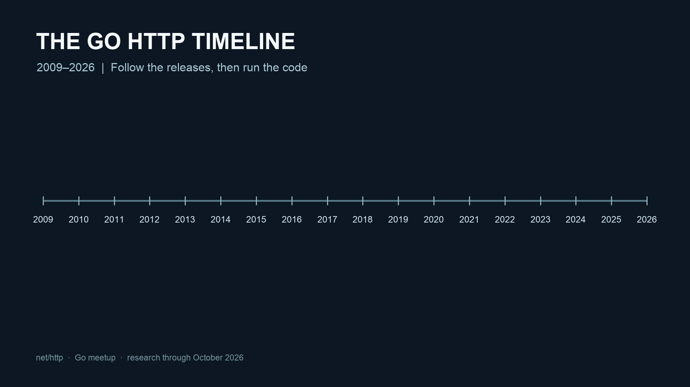
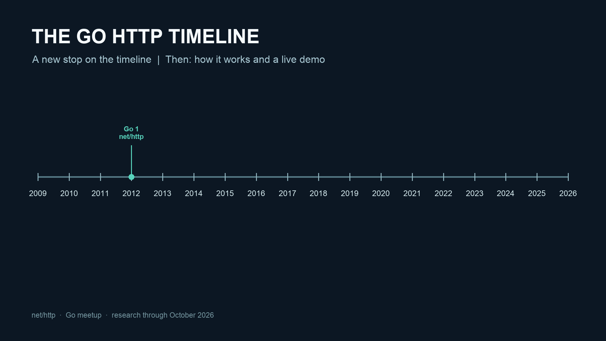
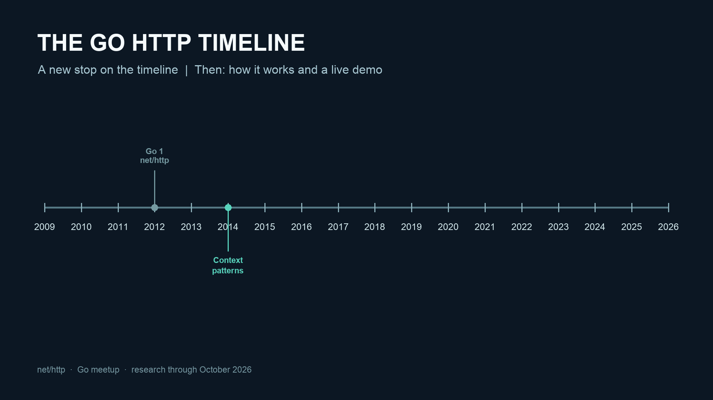
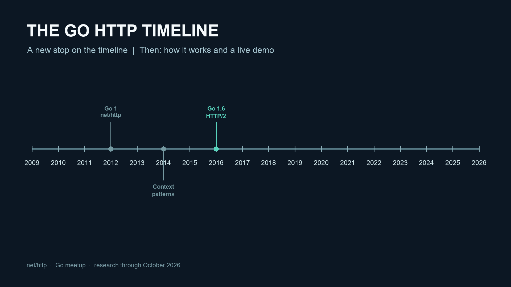
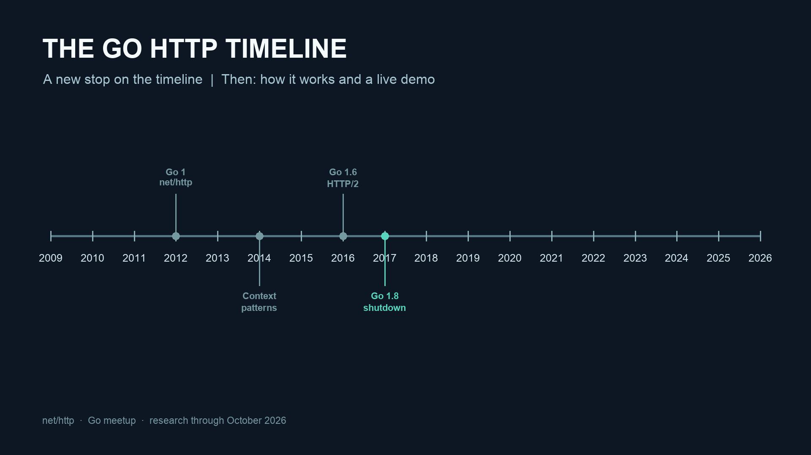
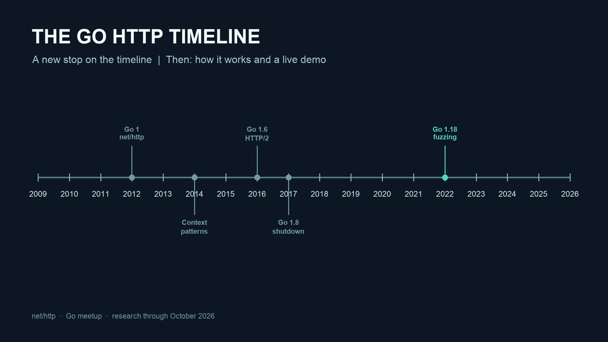
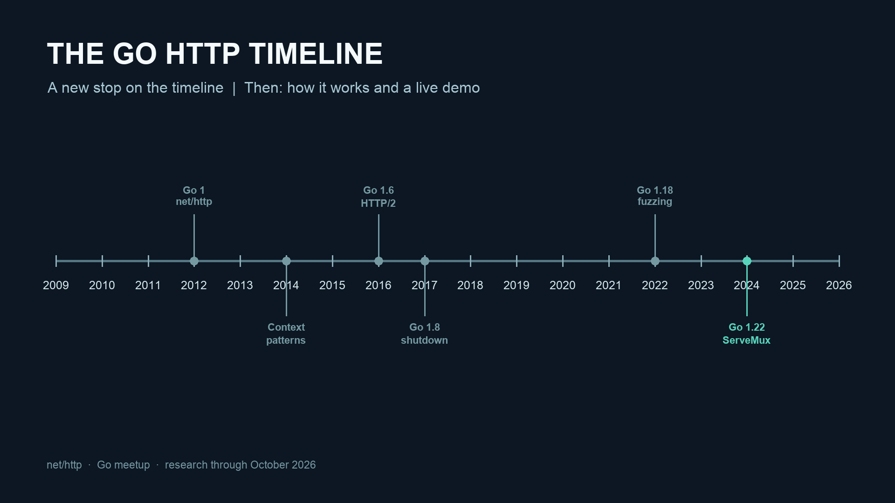
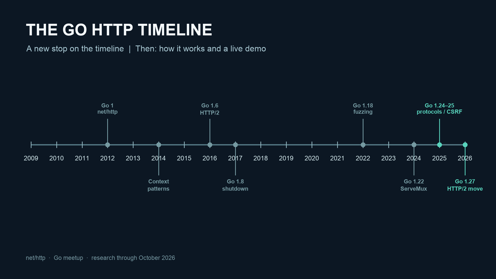

<!-- _class: lead -->

**GO MEETUP | 2009–2026**

# net/http: the timeline

## Know your HTTP stack before an AI agent gaslights you

From handlers and HTTP/2 to routing, security, and testing.

<!-- SPEAKER NOTES
We will follow the package chronologically, returning to the timeline as Go adds features and then using demos to see how they work.
-->
---
<!-- _paginate: false -->



<!-- SPEAKER NOTES
Follow each release milestone, then explain the APIs and run the matching examples. The image shows every year; subsequent timeline slides progressively reveal the changes.
-->
---
<!-- _paginate: false -->



<!-- SPEAKER NOTES
Timeline stop 1: the highlighted milestone is the next section. See research-changelog.md for the underlying release notes and dates.
-->
---

**2009 | ORIGINS**

# The HTTP idea predates Go 1

**BEGINNINGS**

- Go was announced publicly in November 2009.
- The HTTP package and request multiplexer grew out of Go's early networking standard library.
- The design centered on the small Handler contract, not a mandatory web framework.

> The small abstraction made later internal rewrites possible.

*Sources: [Go 1 announcement, 28 Mar 2012](https://go.dev/blog/go1) | [Go 1 release notes](https://go.dev/doc/go1) (additional references in speaker notes)*

<!--
SPEAKER NOTES
The archived Go 1 release notes document the later package path migration. Historical source files carry 2009 copyright notices, but do not treat a copyright date as an exact implementation-release date.
SOURCE LINKS
Go 1 announcement, 28 Mar 2012 - https://go.dev/blog/go1
Go 1 release notes - https://go.dev/doc/go1
Legacy 1.21 ServeMux snapshot - https://go.dev/src/net/http/servemux121.go
-->

---

**2012 | GO 1.0**

# http becomes net/http

**THE COMPATIBILITY PROMISE**

- March 28, 2012: Go 1 establishes a stable language and standard-library base.
- The pre-Go-1 http package moves to net/http.
- Specialized client utilities move to net/http/httputil.
- Compatibility becomes a major design constraint for future HTTP changes.

> Modern net/http is the descendant of the original Go 1 API.

*Sources: [Go 1 announcement, 28 Mar 2012](https://go.dev/blog/go1) | [Go 1 release notes](https://go.dev/doc/go1) (additional references in speaker notes)*

<!--
SPEAKER NOTES
Modern net/http is the descendant of the original Go 1 API.
SOURCE LINKS
Go 1 announcement, 28 Mar 2012 - https://go.dev/blog/go1
Go 1 release notes - https://go.dev/doc/go1
Go release history - https://go.dev/doc/devel/release
-->

---

**ANATOMY | TODAY**

# How a request gets handled

1. **Client:** `http.Client` sends a request using a `Transport`.
2. **Connection:** the transport uses HTTP/1.1 or HTTP/2.
3. **Server:** `http.Server` accepts connections from a listener.
4. **Handler:** the server calls `ServeHTTP` with the request and a `ResponseWriter`.
5. **Response:** the handler writes a status, headers, and body back to the client.

> These are cooperating components, not an inheritance hierarchy.

*Sources: [net/http documentation](https://pkg.go.dev/net/http)*

<!--
SPEAKER NOTES
Adjacent packages include net/http/httptest, httputil, httptrace, cookiejar and pprof. Routers plug into the Handler interface; they are not tied to a protocol version.
SOURCE LINKS
net/http documentation - https://pkg.go.dev/net/http
-->

---

**CORE TYPES | SERVER**

# Follow one request

`Server` accepts a connection → `Handler.ServeHTTP` receives a `*Request` and `ResponseWriter`.

- `HandlerFunc` adapts a function; `ServeMux` selects a handler.
- `ResponseWriter`: set headers before the first write; the first write implies status 200.
- Do not use the writer after the handler returns.

*Source: [net/http](https://pkg.go.dev/net/http)*

---

**2012 ONWARD | API CONTRACT**

# The Handler is the hinge

```go
type Handler interface {
    ServeHTTP(ResponseWriter, *Request)
}

http.HandleFunc("/health", func(w http.ResponseWriter, r *http.Request) {
    w.WriteHeader(http.StatusNoContent)
})
```

- Server dispatch is expressed as an interface.
- HandlerFunc adapts an ordinary function.
- A router, proxy, middleware or single endpoint can all be an http.Handler.

*Sources: [net/http documentation](https://pkg.go.dev/net/http) | [Go 1 release notes](https://go.dev/doc/go1)*

<!--
SPEAKER NOTES
The key architectural insight is decoupling the application from parsing, transport and routing. The code is an idiomatic minimal example; it need not use DefaultServeMux in larger applications.
SOURCE LINKS
net/http documentation - https://pkg.go.dev/net/http
Go 1 release notes - https://go.dev/doc/go1
-->

---

**ROUTING | NO MUX IS VALID**

# You can skip routing entirely

```go
handler := http.HandlerFunc(func(w http.ResponseWriter, r *http.Request) {
    if r.Method != http.MethodGet {
        w.Header().Set("Allow", "GET")
        http.Error(w, "method not allowed", http.StatusMethodNotAllowed)
        return
    }
    fmt.Fprintln(w, "hello")
})
log.Fatal(http.ListenAndServe(":8080", handler))
```

- No router allocation or route table is required.
- The server takes any http.Handler, including a middleware chain.

*Sources: [net/http documentation](https://pkg.go.dev/net/http)*

<!--
SPEAKER NOTES

SOURCE LINKS
net/http documentation - https://pkg.go.dev/net/http
-->

---
**LIVE CODE**

# A handler without a router

```sh
go run . -direct
# Another terminal:
curl -i localhost:8080/
```

Stop the server with Ctrl+C before the next demo.

<!-- SPEAKER NOTES
Run from go-meetup-nethttp/history/examples. These commands use the runnable example module. See its README for setup, Go version requirements and TLS options.
-->
---
<!-- _paginate: false -->



<!-- SPEAKER NOTES
Timeline stop 2: the highlighted milestone is the next section. See research-changelog.md for the underlying release notes and dates.
-->
---

**2014 | A CONCURRENCY MODEL EMERGES**

# A request already has a goroutine

**CONCURRENCY**

- Go's Context blog described an incoming request being served in its own goroutine.
- Handlers may fork concurrent database or RPC calls.
- Cancellation, deadlines and request-scoped values must propagate to all child work.

> Spawn additional goroutines only when there is real concurrent work.

*Sources: [Go Concurrency Patterns: Context (2014)](https://go.dev/blog/context)*

<!--
SPEAKER NOTES
Spawn additional goroutines only when there is real concurrent work.
SOURCE LINKS
Go Concurrency Patterns: Context (2014) - https://go.dev/blog/context
-->

---

**CONCURRENCY | PRACTICAL RULES**

# The request is a bounded lifetime

**GOROUTINES**

- Server dispatch already runs handlers concurrently; shared state needs synchronization.
- Pass r.Context() into outbound requests, queries and child tasks.
- Do not access ResponseWriter or Request.Body from a goroutine after ServeHTTP returns.
- For durable jobs, hand off work to a queue with an independent lifetime.

> Cancellation and ownership matter more than raw goroutine count.

*Sources: [net/http documentation](https://pkg.go.dev/net/http) | [Go Concurrency Patterns: Context (2014)](https://go.dev/blog/context) (additional references in speaker notes)*

<!--
SPEAKER NOTES
Request.Context is canceled when ServeHTTP returns, and the ResponseWriter must not be used after that. HTTP/1 request and response bodies have additional ordering constraints; Go 1.21 added EnableFullDuplex for a controlled exception.
SOURCE LINKS
net/http documentation - https://pkg.go.dev/net/http
Go Concurrency Patterns: Context (2014) - https://go.dev/blog/context
Go 1.21 release notes - https://go.dev/doc/go1.21
-->

---

**CONCURRENCY | FAN-OUT**

# Bound concurrency and wait for your work

```go
g, ctx := errgroup.WithContext(r.Context())
g.SetLimit(4)
for _, id := range ids {
    id := id
    g.Go(func() error {
        return fetchAndStore(ctx, id)
    })
}
if err := g.Wait(); err != nil {
    http.Error(w, "upstream failed", http.StatusBadGateway)
    return
}
w.WriteHeader(http.StatusNoContent)
```

- errgroup is in golang.org/x/sync, not net/http.
- A bounded group and propagated context beat unbounded fire-and-forget.

*Sources: [Go Concurrency Patterns: Context (2014)](https://go.dev/blog/context) | [net/http documentation](https://pkg.go.dev/net/http)*

<!--
SPEAKER NOTES

SOURCE LINKS
Go Concurrency Patterns: Context (2014) - https://go.dev/blog/context
net/http documentation - https://pkg.go.dev/net/http
-->

---
**LIVE CODE**

# Bounded fan-out

```sh
go run .
# Another terminal:
curl -i localhost:8080/fanout
```

The server waits for its child work. Leave it running for route demos.

<!-- SPEAKER NOTES
Run from go-meetup-nethttp/history/examples. These commands use the runnable example module. See its README for setup, Go version requirements and TLS options.
-->
---
<!-- _paginate: false -->



<!-- SPEAKER NOTES
Timeline stop 3: the highlighted milestone is the next section. See research-changelog.md for the underlying release notes and dates.
-->
---

**2015-2016 | GO 1.6**

# HTTP/2 arrives without a new Handler

**TRANSPARENT PROTOCOL SUPPORT**

- Go 1.6 (February 2016) enables HTTP/2 by default for suitable HTTPS clients and servers.
- TLS ALPN negotiates h2, otherwise HTTP/1.x remains available.
- Detailed HTTP/2 settings initially live in golang.org/x/net/http2.

> Application code stays on Request and ResponseWriter.

*Sources: [Go 1.6 release notes](https://go.dev/doc/go1.6) | [HTTP/2 standard library migration proposal (Jun 2023)](https://github.com/golang/go/discussions/60746)*

<!--
SPEAKER NOTES
Historical implementation detail: x/net/http2 was vendored into net/http via a generated h2_bundle.go. That technical debt later motivated the 2023-2026 migration.
SOURCE LINKS
Go 1.6 release notes - https://go.dev/doc/go1.6
HTTP/2 standard library migration proposal (Jun 2023) - https://github.com/golang/go/discussions/60746
-->

---

**2016 | HTTP/2**

# Multiplexed streams are not URL routing

**HTTP/1.1:** concurrent requests generally use multiple connections; one active exchange per connection.

**HTTP/2:** independent streams can share a single connection.

- HTTP/1.1: at most one active request-response exchange per connection.
- HTTP/2: many streams share a single connection, with flow control and frames.
- Both invoke ordinary net/http handlers.

*Sources: [Go 1.6 release notes](https://go.dev/doc/go1.6) | [net/http documentation](https://pkg.go.dev/net/http)*

<!--
SPEAKER NOTES
The diagram is conceptual. HTTP/1.1 clients can use multiple pooled connections. HTTP/2 multiplexing of frames is a transport concern, while ServeMux dispatches HTTP requests by method, host and path.
SOURCE LINKS
Go 1.6 release notes - https://go.dev/doc/go1.6
net/http documentation - https://pkg.go.dev/net/http
-->

---

**ROUTING VOCABULARY**

# Three different things called a mux

### ServeMux - Application routing

Map method / host / path to Handler.

### HTTP/2 multiplexing - Protocol transport

Interleave independent streams on a connection.

### No mux - Direct handler

Server.Handler can be a single HandlerFunc.

> Router choice does not determine whether HTTP/2 is used.

*Sources: [net/http documentation](https://pkg.go.dev/net/http) | [Go 1.6 release notes](https://go.dev/doc/go1.6) (additional references in speaker notes)*

<!--
SPEAKER NOTES
Router choice does not determine whether HTTP/2 is used.
SOURCE LINKS
net/http documentation - https://pkg.go.dev/net/http
Go 1.6 release notes - https://go.dev/doc/go1.6
Routing enhancements, Go blog (13 Feb 2024) - https://go.dev/blog/routing-enhancements
-->

---
**LIVE CODE**

# See HTTP/2 negotiated

```sh
go test -v -run TestHTTP2
```

The test starts a TLS server and asserts that the client negotiated HTTP/2.

<!-- SPEAKER NOTES
Run from go-meetup-nethttp/history/examples. These commands use the runnable example module. See its README for setup, Go version requirements and TLS options.
-->
---
<!-- _paginate: false -->



<!-- SPEAKER NOTES
Timeline stop 4: the highlighted milestone is the next section. See research-changelog.md for the underlying release notes and dates.
-->
---

**CORE TYPES | CLIENT AND LIFETIME**

# The other side of a request

- `Client.Do` manages redirects; `Transport` manages connections and TLS.
- Reuse clients and transports; close `Response.Body`.
- `Request.Context` carries cancellation; set a timeout that fits the work.
- `Server.Shutdown` waits for ordinary active requests, not hijacked connections.

```sh
../demos/run.sh lifetime
```

*Source: [net/http](https://pkg.go.dev/net/http)*

---

**2016-2017 | GO 1.7 AND 1.8**

# Context, shutdown, timeouts

**LIFECYCLE**

- Go 1.7: Request.Context and Request.WithContext link request-scoped work to cancellation.
- Go 1.8: Server.Shutdown enables graceful draining of active connections.
- Go 1.8: ReadHeaderTimeout and IdleTimeout make connection resource control explicit.

> The unit of work is a request with a lifetime, not just a goroutine.

*Sources: [Go 1.7 release notes](https://go.dev/doc/go1.7) | [Go 1.8 release notes](https://go.dev/doc/go1.8) (additional references in speaker notes)*

<!--
SPEAKER NOTES
The unit of work is a request with a lifetime, not just a goroutine.
SOURCE LINKS
Go 1.7 release notes - https://go.dev/doc/go1.7
Go 1.8 release notes - https://go.dev/doc/go1.8
Go Concurrency Patterns: Context (2014) - https://go.dev/blog/context
-->

---

**2017 | LIFECYCLE CODE**

# Operate the server explicitly

```go
srv := &http.Server{
    Addr:              ":8080",
    Handler:           mux,
    ReadHeaderTimeout: 5 * time.Second,
    IdleTimeout:       60 * time.Second,
}
// On process shutdown:
ctx, cancel := context.WithTimeout(context.Background(), 15*time.Second)
defer cancel()
_ = srv.Shutdown(ctx)
```

- Bound header reads, idle connections and shutdown time.
- Shutdown waits for normal active connections; it is not a substitute for stopping hijacked connections.

*Sources: [Go 1.8 release notes](https://go.dev/doc/go1.8) | [net/http documentation](https://pkg.go.dev/net/http)*

<!--
SPEAKER NOTES

SOURCE LINKS
Go 1.8 release notes - https://go.dev/doc/go1.8
net/http documentation - https://pkg.go.dev/net/http
-->

---

**2018-2021 | PRODUCTION HARDENING**

# The boring knobs that matter

**RELIABILITY**

- Go 1.11: Transport.MaxConnsPerHost caps pooled + active outbound connections.
- Go 1.13: ForceAttemptHTTP2 helps when custom dialing/TLS settings are used.
- Go 1.14: httptest.Server.EnableHTTP2 improves protocol-level test coverage.
- Go 1.16-1.17: fs.FS serving and stricter URL/Host handling.

> Connection budgets and protocol parity became first-class concerns.

*Sources: [Go 1.11 release notes](https://go.dev/doc/go1.11) | [Go 1.13 release notes](https://go.dev/doc/go1.13) (additional references in speaker notes)*

<!--
SPEAKER NOTES
Connection budgets and protocol parity became first-class concerns.
SOURCE LINKS
Go 1.11 release notes - https://go.dev/doc/go1.11
Go 1.13 release notes - https://go.dev/doc/go1.13
Go 1.14 release notes - https://go.dev/doc/go1.14
Go 1.16 release notes - https://go.dev/doc/go1.16
Go 1.17 release notes - https://go.dev/doc/go1.17
-->

---

**TODAY | THE CLIENT-SIDE CONTRACT**

# Reuse transports. Close bodies. Budget requests.

**CLIENT BEST PRACTICES**

- Clients and Transports are safe for concurrent use; reuse them to retain connection pooling.
- DefaultTransport supports HTTPS HTTP/2; verify protocol settings when customizing a Transport.
- Use Request.WithContext (or NewRequestWithContext) and Client.Timeout for cancellation.
- Always close Response.Body. Go 1.27 can drain a bounded amount of unread HTTP/1 data to improve reuse.

> Most HTTP client bugs are lifecycle bugs, not routing bugs.

*Sources: [net/http documentation](https://pkg.go.dev/net/http) | [Go 1.13 release notes](https://go.dev/doc/go1.13) (additional references in speaker notes)*

<!--
SPEAKER NOTES
Most HTTP client bugs are lifecycle bugs, not routing bugs.
SOURCE LINKS
net/http documentation - https://pkg.go.dev/net/http
Go 1.13 release notes - https://go.dev/doc/go1.13
Go 1.24 release notes - https://go.dev/doc/go1.24
Go 1.27 release notes - https://go.dev/doc/go1.27
Better HTTP/1 connection reuse, 14 Oct 2026 - https://go.dev/blog/http-connection-reuse
-->

---
**LIVE CODE**

# Shut the server down

```sh
curl -i localhost:8080/health
# In the server terminal: press Ctrl+C
```

The server uses a bounded graceful shutdown; inspect main.go for the lifecycle.

<!-- SPEAKER NOTES
Run from go-meetup-nethttp/history/examples. These commands use the runnable example module. See its README for setup, Go version requirements and TLS options.
-->
---
<!-- _paginate: false -->



<!-- SPEAKER NOTES
Timeline stop 5: the highlighted milestone is the next section. See research-changelog.md for the underlying release notes and dates.
-->
---

**2022 | GO 1.18 AND 1.19**

# The year of testability and hardening

**NOT THE HTTP/2 MOVE YET**

- Go 1.18 introduces native, coverage-guided fuzzing to the Go toolchain.
- Go 1.19 improves HTTP error handling and body-size errors.
- A 2022 HTTP/2 header-cache vulnerability illustrates per-connection memory exposure.
- The later HTTP/2 consolidation was formally proposed in June 2023.

> 2022 sets the pressure; 2023 defines the migration.

*Sources: [Go 1.18 release notes](https://go.dev/doc/go1.18) | [Go 1.19 release notes](https://go.dev/doc/go1.19) (additional references in speaker notes)*

<!--
SPEAKER NOTES
2022 sets the pressure; 2023 defines the migration.
SOURCE LINKS
Go 1.18 release notes - https://go.dev/doc/go1.18
Go 1.19 release notes - https://go.dev/doc/go1.19
GO-2022-1144: HTTP/2 header memory - https://pkg.go.dev/vuln/GO-2022-1144
HTTP/2 standard library migration proposal (Jun 2023) - https://github.com/golang/go/discussions/60746
-->

---

**2023 | GO 1.20**

# ResponseController and safer proxies

**CONTROL AT THE RIGHT LAYER**

- ResponseController exposes per-handler Flush, Hijack and deadline capabilities.
- ReverseProxy.Rewrite gets an immutable inbound request plus an outbound request.
- The old Director hook can be vulnerable to hop-by-hop header removal.

> A stable interface gained modern controls without replacing Handler.

*Sources: [Go 1.20 release notes](https://go.dev/doc/go1.20) | [Go 1.26 release notes](https://go.dev/doc/go1.26)*

<!--
SPEAKER NOTES
A stable interface gained modern controls without replacing Handler.
SOURCE LINKS
Go 1.20 release notes - https://go.dev/doc/go1.20
Go 1.26 release notes - https://go.dev/doc/go1.26
-->

---

**SECURITY | THREAT MODEL**

# What net/http guards - and what it cannot

### RESOURCE LIMITS - Headers, bodies, timeouts

MaxHeaderBytes, MaxBytesReader, ReadHeaderTimeout.

### PROTOCOL BOUNDARIES - TLS, proxy rewriting, path parsing

Validate header semantics; safer ReverseProxy.Rewrite.

### BROWSER REQUESTS - CrossOriginProtection

CSRF mitigation, not authorization.

> None of these replaces identity, business authorization or safe endpoint design.

*Sources: [net/http documentation](https://pkg.go.dev/net/http) | [Go 1.20 release notes](https://go.dev/doc/go1.20) (additional references in speaker notes)*

<!--
SPEAKER NOTES
None of these replaces identity, business authorization or safe endpoint design.
SOURCE LINKS
net/http documentation - https://pkg.go.dev/net/http
Go 1.20 release notes - https://go.dev/doc/go1.20
Go 1.25 release notes - https://go.dev/doc/go1.25
Go 1.27 release notes - https://go.dev/doc/go1.27
-->

---

**LIVE CODE | RESOURCE LIMITS**

# A body can be too large

`MaxBytesReader` limits request bodies. Handle `*http.MaxBytesError` and return 413; a header timeout alone does not bound the body.

```sh
../demos/run.sh security
```

*Source: [http.MaxBytesReader](https://pkg.go.dev/net/http#MaxBytesReader)*

---

**2022 + OCTOBER 2026 | SECURITY LESSONS**

# HTTP parsers and proxies are attack surfaces

**PATCHED VULNERABILITIES**

- 2022: HTTP/2 header-key caching could permit large memory consumption per connection.
- October 2026: malformed HTTP/2 framing-related headers risk response smuggling via an HTTP/1 proxy path.
- October 2026: improperly handled successful CONNECT could risk request smuggling.
- Relevant October fixes shipped in Go 1.26.9 and 1.27.2; stay on patched releases.

> Protocol transitions deserve adversarial tests, not just happy-path tests.

*Sources: [GO-2022-1144: HTTP/2 header memory](https://pkg.go.dev/vuln/GO-2022-1144) | [GO-2026-6610: HTTP/2 header handling](https://pkg.go.dev/vuln/GO-2026-6610) (additional references in speaker notes)*

<!--
SPEAKER NOTES
Protocol transitions deserve adversarial tests, not just happy-path tests.
SOURCE LINKS
GO-2022-1144: HTTP/2 header memory - https://pkg.go.dev/vuln/GO-2022-1144
GO-2026-6610: HTTP/2 header handling - https://pkg.go.dev/vuln/GO-2026-6610
GO-2026-6613: CONNECT request smuggling - https://pkg.go.dev/vuln/GO-2026-6613
Go release history - https://go.dev/doc/devel/release
-->

---

**2023 | TECHNICAL DEBT**

# Why HTTP/2 was hard to maintain

**Previous source path:** `x/net/http2` -> bundle tool -> `net/http/h2_bundle.go`

- The source of truth lived in x/net/http2, outside the Go standard library.
- A bundle tool generated h2_bundle.go inside net/http.
- HTTP/2 tuning could select a different implementation.
- Testing and security fixes had to cross repositories and release cycles.

*Sources: [HTTP/2 standard library migration proposal (Jun 2023)](https://github.com/golang/go/discussions/60746) | [x/net/http2 README and migration notes](https://pkg.go.dev/golang.org/x/net/http2)*

<!--
SPEAKER NOTES
This is the specific technical motivation from the 12 June 2023 HTTP/2 migration proposal. The old arrangement existed from transparent Go 1.6 HTTP/2 support until the Go 1.27 source-of-truth change.
SOURCE LINKS
HTTP/2 standard library migration proposal (Jun 2023) - https://github.com/golang/go/discussions/60746
x/net/http2 README and migration notes - https://pkg.go.dev/golang.org/x/net/http2
-->

---

**JUNE 2023 | DESIGN PROPOSAL**

# Move the source of truth into std

**PROPOSAL #60746**

- Move HTTP/2 internals into net/http/internal/http2.
- Add protocol selection and HTTP/2 configuration directly to net/http.
- Preserve compatibility for existing x/net/http2 consumers through wrappers.
- Consolidate testing, development and security backports.

> Proposal in 2023; public API staging in 2025-26; migration lands in 2026.

*Sources: [HTTP/2 standard library migration proposal (Jun 2023)](https://github.com/golang/go/discussions/60746) | [x/net/http2 README and migration notes](https://pkg.go.dev/golang.org/x/net/http2) (additional references in speaker notes)*

<!--
SPEAKER NOTES
Proposal in 2023; public API staging in 2025-26; migration lands in 2026.
SOURCE LINKS
HTTP/2 standard library migration proposal (Jun 2023) - https://github.com/golang/go/discussions/60746
x/net/http2 README and migration notes - https://pkg.go.dev/golang.org/x/net/http2
Go 1.24 release notes - https://go.dev/doc/go1.24
Go 1.27 release notes - https://go.dev/doc/go1.27
-->

---
<!-- _paginate: false -->



<!-- SPEAKER NOTES
Timeline stop 6: the highlighted milestone is the next section. See research-changelog.md for the underlying release notes and dates.
-->
---

**JULY 2023 -> FEBRUARY 2024**

# The other major rework: ServeMux

**GO 1.22**

- Proposal #61410 (July 2023) responds to common web-router use cases.
- Go 1.22 adds HTTP-method patterns: "GET /posts/{id}".
- Wildcards, PathValue and automatic 405 responses remove repetitive handler code.
- Routes still implement the same http.Handler interface.

> A large routing migration, not a language Go 2 release.

*Sources: [ServeMux proposal #61410 (Jul 2023)](https://github.com/golang/go/issues/61410) | [Go 1.22 release notes](https://go.dev/doc/go1.22) (additional references in speaker notes)*

<!--
SPEAKER NOTES
A large routing migration, not a language Go 2 release.
SOURCE LINKS
ServeMux proposal #61410 (Jul 2023) - https://github.com/golang/go/issues/61410
Go 1.22 release notes - https://go.dev/doc/go1.22
Routing enhancements, Go blog (13 Feb 2024) - https://go.dev/blog/routing-enhancements
-->

---

**2024 | NEW ROUTING SYNTAX**

# A router in the standard library

```go
mux := http.NewServeMux()
mux.HandleFunc("GET /posts/{id}", func(w http.ResponseWriter, r *http.Request) {
    id := r.PathValue("id")
    fmt.Fprintln(w, id)
})
mux.HandleFunc("POST /posts", createPost)

// GET also matches HEAD. Unsupported methods get 405 + Allow.
// A missing path gets 404.
```

- Method and path belong in the route declaration.
- Wildcard values are available through Request.PathValue.

*Sources: [Routing enhancements, Go blog (13 Feb 2024)](https://go.dev/blog/routing-enhancements) | [Go 1.22 release notes](https://go.dev/doc/go1.22)*

<!--
SPEAKER NOTES

SOURCE LINKS
Routing enhancements, Go blog (13 Feb 2024) - https://go.dev/blog/routing-enhancements
Go 1.22 release notes - https://go.dev/doc/go1.22
-->

---

**LIVE CODE | ROUTING HICCUPS**

# Routes can conflict at startup

`ServeMux` prefers the more specific pattern. Ambiguous overlapping registrations panic; a method mismatch returns 405 and `Allow`.

```sh
../demos/run.sh routing
```

*Source: [Routing Enhancements for Go 1.22](https://go.dev/blog/routing-enhancements)*

---

**2024 | MATCHING SEMANTICS**

# Most specific wins - not last registered

### /posts/latest - Exact path

Wins for GET /posts/latest

### GET /posts/{id} - Method + wildcard

Matches GET and HEAD

### /posts/{id} - Any method

Fallback if method allowed

- Order-independent routing is a key ServeMux property.
- Conflicting overlapping patterns panic at registration.
- Host-specific patterns retain their special precedence rule.

*Sources: [Routing enhancements, Go blog (13 Feb 2024)](https://go.dev/blog/routing-enhancements) | [Go 1.22 release notes](https://go.dev/doc/go1.22)*

<!--
SPEAKER NOTES

SOURCE LINKS
Routing enhancements, Go blog (13 Feb 2024) - https://go.dev/blog/routing-enhancements
Go 1.22 release notes - https://go.dev/doc/go1.22
-->

---

**2024 | COMPATIBILITY**

# Routing upgrades are not entirely free

**GODEBUG=httpmuxgo121=1**

- In Go 1.21, braces in route patterns were literal text; in Go 1.22 they denote wildcards.
- The new mux unescapes paths segment by segment.
- GODEBUG=httpmuxgo121=1 restores Go 1.21-style matching for migration.
- Audit route conflicts, HEAD behavior, redirects and escaped slashes.

> Routing is part of an application's externally visible behavior.

*Sources: [Go 1.22 release notes](https://go.dev/doc/go1.22) | [Routing enhancements, Go blog (13 Feb 2024)](https://go.dev/blog/routing-enhancements) (additional references in speaker notes)*

<!--
SPEAKER NOTES
Routing is part of an application's externally visible behavior.
SOURCE LINKS
Go 1.22 release notes - https://go.dev/doc/go1.22
Routing enhancements, Go blog (13 Feb 2024) - https://go.dev/blog/routing-enhancements
Legacy 1.21 ServeMux snapshot - https://go.dev/src/net/http/servemux121.go
-->

---

**2024 | GO 1.23**

# Small changes that make routers usable

**REFINEMENT**

- Request.Pattern exposes the selected ServeMux pattern.
- httptest.NewRequestWithContext simplifies context-sensitive handler tests.
- Cookie parsing expands to quoted and partitioned cookies.

> Observe the logical route, not only the raw URL.

*Sources: [Go 1.23 release notes](https://go.dev/doc/go1.23) | [net/http/httptest documentation](https://pkg.go.dev/net/http/httptest)*

<!--
SPEAKER NOTES
Observe the logical route, not only the raw URL.
SOURCE LINKS
Go 1.23 release notes - https://go.dev/doc/go1.23
net/http/httptest documentation - https://pkg.go.dev/net/http/httptest
-->

---

**ROUTER CHOICE**

# ServeMux versus third-party routing

| Option | Best when | Tradeoff |
| --- | --- | --- |
| HandlerFunc only | One endpoint or custom dispatch | Branch manually |
| net/http.ServeMux | Most small or medium APIs | Fewer advanced grouping features |
| chi | Nested routes + middleware groups | Dependency + its own conventions |
| httprouter | Explicit params; performance focus | Different params/handler options |
| gorilla/mux | Host, query, regex matchers | Broader API + dependency |

*Sources: [net/http documentation](https://pkg.go.dev/net/http) | [Routing enhancements, Go blog (13 Feb 2024)](https://go.dev/blog/routing-enhancements) (additional references in speaker notes)*

<!--
SPEAKER NOTES
All can integrate with the standard HTTP server through http.Handler. This is a qualitative interface comparison, not a performance benchmark. Go 1.22 narrowed the routing feature gap but did not eliminate all reasons to use third-party routers.
SOURCE LINKS
net/http documentation - https://pkg.go.dev/net/http
Routing enhancements, Go blog (13 Feb 2024) - https://go.dev/blog/routing-enhancements
chi router docs - https://pkg.go.dev/github.com/go-chi/chi/v5
httprouter docs - https://pkg.go.dev/github.com/julienschmidt/httprouter
gorilla/mux docs - https://pkg.go.dev/github.com/gorilla/mux
-->

---

**COMPOSITION | MIDDLEWARE**

# Routing and authorization solve different problems

- The server invokes a handler wrapped with CSRF or authentication middleware.
- A router such as `ServeMux` or chi selects an endpoint handler.
- The endpoint passes `Request.Context` to downstream calls so cancellation and deadlines propagate.
- Routing selects a handler; authorization decides whether an action is allowed.

*Sources: [net/http documentation](https://pkg.go.dev/net/http) | [Go 1.25 release notes](https://go.dev/doc/go1.25) (additional references in speaker notes)*

<!--
SPEAKER NOTES

SOURCE LINKS
net/http documentation - https://pkg.go.dev/net/http
Go 1.25 release notes - https://go.dev/doc/go1.25
chi router docs - https://pkg.go.dev/github.com/go-chi/chi/v5
-->

---
**LIVE CODE**

# Run routes and method checks

```sh
go run .
# Another terminal:
curl -i localhost:8080/posts/42
curl -i -X PUT localhost:8080/posts/42
go test -v -run "TestPostRoute|TestMethodsAndFanout"
```

GET also matches HEAD; a method mismatch returns 405 with an Allow header.

<!-- SPEAKER NOTES
Run from go-meetup-nethttp/history/examples. These commands use the runnable example module. See its README for setup, Go version requirements and TLS options.
-->
---

**TESTING | UNIT LEVEL**

# Start at the Handler boundary

```go
func TestPostRoute(t *testing.T) {
    mux := http.NewServeMux()
    mux.HandleFunc("GET /posts/{id}", showPost)
    req := httptest.NewRequest(http.MethodGet, "/posts/42", nil)
    rec := httptest.NewRecorder()
    mux.ServeHTTP(rec, req)
    res := rec.Result()
    defer res.Body.Close()
    if res.StatusCode != http.StatusOK {
        t.Fatalf("status: %d", res.StatusCode)
    }
}
```

- Fast: no live listener and no TLS setup.
- Assert status, Allow header, route variables and body.

*Sources: [net/http/httptest documentation](https://pkg.go.dev/net/http/httptest) | [Go 1.22 release notes](https://go.dev/doc/go1.22)*

<!--
SPEAKER NOTES
This is a test sketch: showPost is an application-defined HandlerFunc. ResponseRecorder.Result returns a response snapshot and should be called after handler execution.
SOURCE LINKS
net/http/httptest documentation - https://pkg.go.dev/net/http/httptest
Go 1.22 release notes - https://go.dev/doc/go1.22
-->

---
<!-- _paginate: false -->



<!-- SPEAKER NOTES
Timeline stop 7: the highlighted milestone is the next section. See research-changelog.md for the underlying release notes and dates.
-->
---

**2025 | GO 1.24**

# HTTP/2 becomes configurable in net/http

**PROTOCOLS + HTTP2CONFIG**

- Server.Protocols and Transport.Protocols select supported protocol families.
- Server.HTTP2 and Transport.HTTP2 expose HTTP/2 tuning directly.
- Unencrypted HTTP/2 is supported with prior knowledge.
- Deprecated HTTP/1 Upgrade: h2c negotiation is not supported by this API.

> Part of the 2023 consolidation proposal finally reaches the public API.

*Sources: [Go 1.24 release notes](https://go.dev/doc/go1.24) | [HTTP/2 standard library migration proposal (Jun 2023)](https://github.com/golang/go/discussions/60746) (additional references in speaker notes)*

<!--
SPEAKER NOTES
Part of the 2023 consolidation proposal finally reaches the public API.
SOURCE LINKS
Go 1.24 release notes - https://go.dev/doc/go1.24
HTTP/2 standard library migration proposal (Jun 2023) - https://github.com/golang/go/discussions/60746
net/http documentation - https://pkg.go.dev/net/http
-->

---

**2025 | PROTOCOL SELECTION**

# Choose protocol semantics explicitly

```go
p := new(http.Protocols)
p.SetHTTP1(true)
p.SetHTTP2(true)

srv := &http.Server{
    Addr:      ":8443",
    Handler:   mux,
    Protocols: p,
}
// With TLS configured, h2 can be negotiated via ALPN.
```

- HTTP/1 and HTTP/2 share application handlers.
- h2c is separate from TLS HTTP/2; enable only where appropriate.

*Sources: [Go 1.24 release notes](https://go.dev/doc/go1.24) | [net/http documentation](https://pkg.go.dev/net/http)*

<!--
SPEAKER NOTES

SOURCE LINKS
Go 1.24 release notes - https://go.dev/doc/go1.24
net/http documentation - https://pkg.go.dev/net/http
-->

---

**2025 | GO 1.25**

# CSRF protection enters net/http

**CrossOriginProtection**

- CrossOriginProtection rejects unsafe cross-origin browser requests.
- It evaluates Sec-Fetch-Site and/or Origin against Host.
- GET, HEAD and OPTIONS are treated as safe methods.
- Requests without these browser headers are allowed; authentication and authorization remain application concerns.

> Security middleware is a boundary, not a substitute for application policy.

*Sources: [Go 1.25 release notes](https://go.dev/doc/go1.25) | [net/http CrossOriginProtection API](https://pkg.go.dev/net/http#CrossOriginProtection)*

<!--
SPEAKER NOTES
Security middleware is a boundary, not a substitute for application policy.
SOURCE LINKS
Go 1.25 release notes - https://go.dev/doc/go1.25
net/http CrossOriginProtection API - https://pkg.go.dev/net/http#CrossOriginProtection
-->

---

**2025 | A TESTING BREAKTHROUGH**

# HTTP/2 exposed the limits of timing tests

**testing/synctest**

- The Go team described difficulty reliably testing HTTP/2 concurrency with fake clocks and custom quiescence instrumentation.
- Go 1.24 experimented with testing/synctest.
- Go 1.25 stabilized it: deterministic fake time, goroutine quiescence, no sleeps to guess at timing.

> Concurrency tests should assert behavior, not race the scheduler.

*Sources: [Testing Time (and other asynchronicities), 2025](https://go.dev/blog/testing-time) | [Go 1.24 release notes](https://go.dev/doc/go1.24) (additional references in speaker notes)*

<!--
SPEAKER NOTES
Concurrency tests should assert behavior, not race the scheduler.
SOURCE LINKS
Testing Time (and other asynchronicities), 2025 - https://go.dev/blog/testing-time
Go 1.24 release notes - https://go.dev/doc/go1.24
Go 1.25 release notes - https://go.dev/doc/go1.25
-->

---

**2026 | GO 1.26**

# Transport primitives and proxy cleanup

**MIGRATION CONTINUES**

- Transport.NewClientConn exposes a non-pooled connection for custom management.
- HTTP2Config.StrictMaxConcurrentRequests offers stream-limit behavior control.
- ReverseProxy.Director is deprecated in favor of the safer Rewrite hook.
- ServeMux trailing-slash redirects now use 307 instead of 301.

> HTTP/2 knobs and proxy boundaries converge on net/http.

*Sources: [Go 1.26 release notes](https://go.dev/doc/go1.26) | [net/http documentation](https://pkg.go.dev/net/http)*

<!--
SPEAKER NOTES
HTTP/2 knobs and proxy boundaries converge on net/http.
SOURCE LINKS
Go 1.26 release notes - https://go.dev/doc/go1.26
net/http documentation - https://pkg.go.dev/net/http
-->

---

**AUGUST 2026 | GO 1.27**

# The HTTP/2 migration completes

**New source path:** `net/http/internal/http2`; `x/net/http2` retains compatibility APIs.

- net/http/internal/http2 becomes the source of truth for HTTP/2.
- x/net/http2 remains for compatibility; newer Go versions can wrap stdlib behavior.
- New HTTP/2 feature work moves to the standard library.
- Normal clients and handlers continue using net/http.

> A three-year staged migration is completed without a new Handler API.

*Sources: [x/net/http2 README and migration notes](https://pkg.go.dev/golang.org/x/net/http2) | [Go 1.27 HTTP/2 glue source](https://go.dev/src/net/http/http2.go) (additional references in speaker notes)*

<!--
SPEAKER NOTES
A three-year staged migration is completed without a new Handler API.
SOURCE LINKS
x/net/http2 README and migration notes - https://pkg.go.dev/golang.org/x/net/http2
Go 1.27 HTTP/2 glue source - https://go.dev/src/net/http/http2.go
Go 1.27 release notes - https://go.dev/doc/go1.27
-->

---

**2026 | GO 1.27**

# Performance, priority, and observability

**NEW OPERATING BASELINE**

- HTTP/2 server honors modern client priority signals (RFC 9218).
- HTTP/1 Transport automatically drains limited unread response bytes on close.
- Server.MaxHeaderValueCount limits header-value counts.
- httptest.NewTestServer and goroutineleak profiling improve tests and debugging.

> The API stayed recognizable while operations became more sophisticated.

*Sources: [Go 1.27 release notes](https://go.dev/doc/go1.27) | [Better HTTP/1 connection reuse, 14 Oct 2026](https://go.dev/blog/http-connection-reuse) (additional references in speaker notes)*

<!--
SPEAKER NOTES
The API stayed recognizable while operations became more sophisticated.
SOURCE LINKS
Go 1.27 release notes - https://go.dev/doc/go1.27
Better HTTP/1 connection reuse, 14 Oct 2026 - https://go.dev/blog/http-connection-reuse
Goroutine Leak Profiles, Sep 2026 - https://go.dev/blog/goroutine-leak-profiles
net/http/httptest documentation - https://pkg.go.dev/net/http/httptest
-->

---

**TESTING | INTEGRATION LEVEL**

# Then test over the wire

**httptest**

- httptest.NewServer exercises HTTP/1 end-to-end with a local listener.
- httptest.NewTLSServer / EnableHTTP2 test TLS and negotiated HTTP/2.
- Go's own tests run shared client/server cases across protocol modes.
- Go 1.27 adds httptest.NewTestServer for in-memory fake network tests.

> Unit tests catch Handler logic; integration tests catch protocol behavior.

*Sources: [net/http/httptest documentation](https://pkg.go.dev/net/http/httptest) | [Go 1.14 release notes](https://go.dev/doc/go1.14) (additional references in speaker notes)*

<!--
SPEAKER NOTES
Unit tests catch Handler logic; integration tests catch protocol behavior.
SOURCE LINKS
net/http/httptest documentation - https://pkg.go.dev/net/http/httptest
Go 1.14 release notes - https://go.dev/doc/go1.14
net/http clientserver_test.go (repository source) - https://go.dev/src/net/http/clientserver_test.go
Go 1.27 release notes - https://go.dev/doc/go1.27
-->

---

**TESTING | DETERMINISTIC CONCURRENCY**

# No time.Sleep guesses

```go
func TestSlowEndpoint(t *testing.T) {
    synctest.Test(t, func(t *testing.T) {
        ts := httptest.NewTestServer(t, http.HandlerFunc(
            func(w http.ResponseWriter, r *http.Request) {
                time.Sleep(5 * time.Second) // fake time
                w.WriteHeader(http.StatusNoContent)
            }))
        resp, err := ts.Client().Get(ts.URL)
        if err != nil { t.Fatal(err) }
        defer resp.Body.Close()
        if resp.StatusCode != 204 { t.Fatal(resp.Status) }
    })
}
```

- Requires Go 1.27 for NewTestServer.
- Fake time advances when bubble goroutines are blocked.

*Sources: [Testing Time (and other asynchronicities), 2025](https://go.dev/blog/testing-time) | [net/http/httptest documentation](https://pkg.go.dev/net/http/httptest) (additional references in speaker notes)*

<!--
SPEAKER NOTES
This is a compact illustrative code example, not a measured benchmark. testing/synctest has been stable since Go 1.25. NewTestServer avoids real loopback networking that can undermine deterministic fake-clock tests.
SOURCE LINKS
Testing Time (and other asynchronicities), 2025 - https://go.dev/blog/testing-time
net/http/httptest documentation - https://pkg.go.dev/net/http/httptest
Go 1.27 release notes - https://go.dev/doc/go1.27
-->

---
**LIVE CODE**

# Run the tests

```sh
go test -race ./...
go test -v -run TestSlowEndpoint
```

TestSlowEndpoint uses fake time and requires Go 1.27; earlier versions skip it.

<!-- SPEAKER NOTES
Run from go-meetup-nethttp/history/examples. These commands use the runnable example module. See its README for setup, Go version requirements and TLS options.
-->
---

**PACKAGE MAP | FIND THE RIGHT TOOL**

# Related HTTP packages

- `net/http`: handlers, clients, servers, routing and cookies.
- `net/http/httptest`: recorder and test servers.
- `net/http/httputil`: reverse proxy and request/response dumps.
- `net/http/httptrace`: client request lifecycle hooks.
- `net/http/cookiejar` and `net/http/pprof`: cookie storage and profiling.

*Source: [Go standard library](https://pkg.go.dev/std)*

---

**TESTING | THE MATRIX**

# How the HTTP stack is tested

### BEHAVIOR - Table-driven + httptest

Handler, routes, redirects, headers, cookies.

### PROTOCOL - Cross-mode integration + fuzz

HTTP/1, TLS, HTTP/2, malformed input, limits.

### CONCURRENCY - Race detector + synctest + pprof

Cancellation, fake time, leak analysis.

> Useful commands: go test ./...  |  go test -race ./...  |  go test -fuzz=FuzzXxx

*Sources: [net/http clientserver_test.go (repository source)](https://go.dev/src/net/http/clientserver_test.go) | [net/http serve_test.go (repository source)](https://go.dev/src/net/http/serve_test.go) (additional references in speaker notes)*

<!--
SPEAKER NOTES
The Go repository's clientserver_test.go shares cases across modes. Fuzzing is available in the toolchain since Go 1.18. The goroutineleak pprof endpoint is a diagnostic and does not detect every possible leak.
SOURCE LINKS
net/http clientserver_test.go (repository source) - https://go.dev/src/net/http/clientserver_test.go
net/http serve_test.go (repository source) - https://go.dev/src/net/http/serve_test.go
Go fuzzing guide - https://go.dev/doc/security/fuzz/
Testing Time (and other asynchronicities), 2025 - https://go.dev/blog/testing-time
Goroutine Leak Profiles, Sep 2026 - https://go.dev/blog/goroutine-leak-profiles
-->

---

**UPGRADING | TODAY**

# What to check when you adopt modern net/http

**ENGINEERING CHECKLIST**

- Go 1.22+: test all ServeMux registrations and 405/HEAD/escaping behavior.
- Go 1.24+: configure Protocols and HTTP2 only when you need specific behavior.
- Go 1.25+: consider CrossOriginProtection for browser-facing state-changing routes.
- Go 1.27+: retest HTTP/2 custom transports and response-body reuse; apply October security patches.

> Modernize behavior with tests, not merely a compiler upgrade.

*Sources: [Go 1.22 release notes](https://go.dev/doc/go1.22) | [Go 1.24 release notes](https://go.dev/doc/go1.24) (additional references in speaker notes)*

<!--
SPEAKER NOTES
Modernize behavior with tests, not merely a compiler upgrade.
SOURCE LINKS
Go 1.22 release notes - https://go.dev/doc/go1.22
Go 1.24 release notes - https://go.dev/doc/go1.24
Go 1.25 release notes - https://go.dev/doc/go1.25
Go 1.27 release notes - https://go.dev/doc/go1.27
Go release history - https://go.dev/doc/devel/release
-->

---

**CONCLUSION | OCTOBER 2026**

# The model for durable infrastructure

- Keep the contract small.
- Make transport and routing swappable.
- Make cancellation, limits and trust boundaries explicit.
- Test adversarial protocol behavior and concurrent lifetimes.

> net/http is a history of changing internals without changing the developer mental model.

*Sources: [net/http documentation](https://pkg.go.dev/net/http) | [HTTP/2 standard library migration proposal (Jun 2023)](https://github.com/golang/go/discussions/60746) (additional references in speaker notes)*

<!--
SPEAKER NOTES
net/http is a history of changing internals without changing the developer mental model.
SOURCE LINKS
net/http documentation - https://pkg.go.dev/net/http
HTTP/2 standard library migration proposal (Jun 2023) - https://github.com/golang/go/discussions/60746
Go 1.27 release notes - https://go.dev/doc/go1.27
-->

---

**ANNOTATED SOURCES | 1 / 2**

# Release notes and design records

- Go 1 and release history: go.dev/doc/go1  |  go.dev/doc/devel/release
- Go 1.6, 1.7, 1.8, 1.18-1.27: go.dev/doc/go1.X
- HTTP/2 migration proposal: github.com/golang/go/discussions/60746
- ServeMux proposal: github.com/golang/go/issues/61410
- Routing explainer: go.dev/blog/routing-enhancements

*Sources: [Go 1 release notes](https://go.dev/doc/go1) | [Go release history](https://go.dev/doc/devel/release) (additional references in speaker notes)*

<!--
SPEAKER NOTES

SOURCE LINKS
Go 1 release notes - https://go.dev/doc/go1
Go release history - https://go.dev/doc/devel/release
HTTP/2 standard library migration proposal (Jun 2023) - https://github.com/golang/go/discussions/60746
ServeMux proposal #61410 (Jul 2023) - https://github.com/golang/go/issues/61410
Routing enhancements, Go blog (13 Feb 2024) - https://go.dev/blog/routing-enhancements
-->

---

**ANNOTATED SOURCES | 2 / 2**

# Code, testing, and vulnerabilities

- API + internal tests: pkg.go.dev/net/http and go.dev/src/net/http/clientserver_test.go
- Testing Time: go.dev/blog/testing-time  |  httptest: pkg.go.dev/net/http/httptest
- Go HTTP/2 source: pkg.go.dev/golang.org/x/net/http2
- Security reports: GO-2022-1144, GO-2026-6610, GO-2026-6613
- Transport update: go.dev/blog/http-connection-reuse

*Sources: [net/http documentation](https://pkg.go.dev/net/http) | [net/http clientserver_test.go (repository source)](https://go.dev/src/net/http/clientserver_test.go) (additional references in speaker notes)*

<!--
SPEAKER NOTES

SOURCE LINKS
net/http documentation - https://pkg.go.dev/net/http
net/http clientserver_test.go (repository source) - https://go.dev/src/net/http/clientserver_test.go
Testing Time (and other asynchronicities), 2025 - https://go.dev/blog/testing-time
net/http/httptest documentation - https://pkg.go.dev/net/http/httptest
x/net/http2 README and migration notes - https://pkg.go.dev/golang.org/x/net/http2
GO-2022-1144: HTTP/2 header memory - https://pkg.go.dev/vuln/GO-2022-1144
GO-2026-6610: HTTP/2 header handling - https://pkg.go.dev/vuln/GO-2026-6610
GO-2026-6613: CONNECT request smuggling - https://pkg.go.dev/vuln/GO-2026-6613
Better HTTP/1 connection reuse, 14 Oct 2026 - https://go.dev/blog/http-connection-reuse
-->
